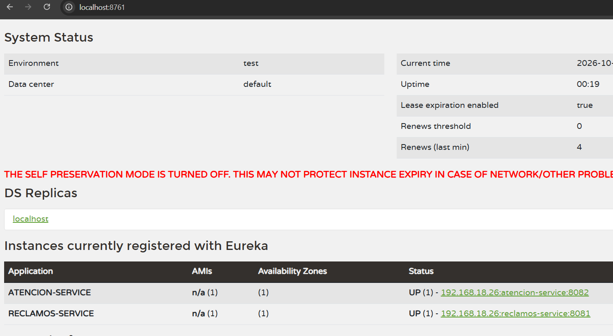

# PAGOYA Perú — Eureka, reclamos y resolución

Proyecto de práctica en Java 17, Spring Boot 3.5.15 y Spring Cloud 2025.0.3. Spring Cloud 2025.0.x es compatible con Spring Boot 3.5.x ([matriz oficial](https://spring.io/projects/spring-cloud/)).

## Abrir en IntelliJ IDEA

1. Abre la carpeta raíz que contiene este `pom.xml`.
2. Acepta **Load Maven Project** cuando IntelliJ lo solicite y selecciona un JDK 17.
3. Espera a que termine la descarga de dependencias. También puedes ejecutar `mvn clean package` desde la terminal de IntelliJ.
4. Inicia las aplicaciones en este orden, cada una en una configuración/terminal distinta:
   - `EurekaServerApplication` (puerto 8761)
   - `ReclamosApplication` (puerto 8081)
   - `ResolucionApplication` (puerto 8082)
5. Abre `http://localhost:8761`. En **Instances currently registered with Eureka** deben aparecer `SERVICIO-RECLAMOS` y `SERVICIO-RESOLUCION`.

Los mismos servicios pueden iniciarse desde la raíz con Maven: `mvn -pl eureka-server spring-boot:run`, `mvn -pl reclamos-service spring-boot:run` y `mvn -pl resolucion-service spring-boot:run`. Inicia cada comando en una terminal separada.

## API

### Registrar un reclamo — `POST http://localhost:8081/api/reclamos`

```json
{
  "nomcliente": "María Pérez",
  "ultimos4tarjeta": "4821",
  "motivo": "Consumo no reconocido en comercio XYZ"
}
```

Responde `201 Created`. `numreclamo` se asigna automáticamente (el primer valor es 1001); `fechareclamo` usa la fecha actual si no se envía. La respuesta incluye `analista: "No asignado"`, `estado: 1` y `observacion: "por evaluar"` por defecto.

### Consultar — `GET http://localhost:8081/api/reclamos/1001`

Devuelve `200 OK` y el objeto del reclamo. Si no existe, responde `404 Not Found` con un mensaje JSON.

### Actualizar — `PUT http://localhost:8081/api/reclamos/1001`

```json
{
  "analista": "Lucía Torres",
  "estado": 2,
  "observacion": "Se verificó el consumo y se abonará el importe."
}
```

Permite actualizar analista, estado y observación; responde el reclamo actualizado o `404` si el número no existe. Este método lo usa también el servicio de resolución.

### Resolver — `POST http://localhost:8082/api/resoluciones/1001`

```json
{
  "estado": 2,
  "analista": "Lucía Torres",
  "observacion": "Consumo desconocido confirmado; corresponde el extorno."
}
```

Use estado `2` para procedente o `3` para improcedente. La observación es opcional y recibe un texto predeterminado según el estado cuando se omite. El servicio valida el reclamo, llama a Reclamos por OpenFeign y devuelve un mensaje y el objeto actualizado. Ejemplo:

```json
{
  "mensaje": "Reclamo resuelto como procedente",
  "reclamo": {
    "numreclamo": 1001,
    "fechareclamo": "2026-10-10",
    "nomcliente": "María Pérez",
    "ultimos4tarjeta": "4821",
    "motivo": "Consumo no reconocido en comercio XYZ",
    "analista": "Lucía Torres",
    "estado": 2,
    "observacion": "Consumo desconocido confirmado; corresponde el extorno."
  }
}
```

## Alcance de almacenamiento

Los reclamos se guardan en memoria para mantener el ejercicio autocontenido: al reiniciar `servicio-reclamos`, los registros se reinician. Para producción se conectaría una base de datos.

# Evidencias

## Eureka Server


